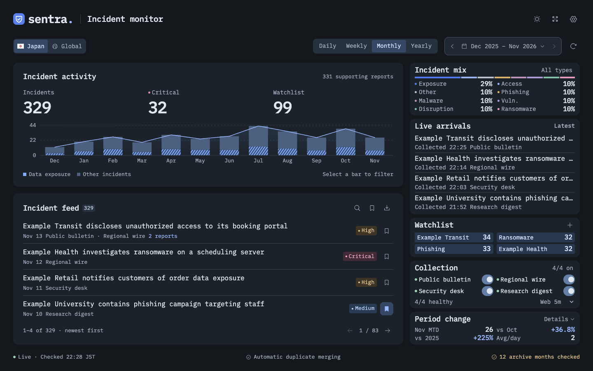

# Sentra Incident Monitor

Sentra is a local dashboard for tracking publicly reported cybersecurity incidents. It monitors Japanese and global publishers, groups related reports into incidents, and updates open dashboards as new reports are collected.



## Quick start

Use Node.js 22.13 or newer. Node.js 24 is recommended.

```sh
npm ci
npm run build
npm start
```

Open [Sentra on localhost](http://127.0.0.1:3000/). A fresh install collects reports from the built-in sources and stores them in a local SQLite database. The first scan can take a few minutes.

To run with Vite during development, use `npm run dev`. To collect from the command line, use `npm run collect` for the current month or pass an archive month, for example `npm run collect -- 2026-04`.

## Run with Docker

```sh
docker compose up --build -d
```

Open [Sentra on localhost](http://127.0.0.1:3000/). Docker Compose publishes the app on loopback and stores the database in the `sentra-data` volume. Use `docker compose down` to stop the app while retaining that volume.

## Using the dashboard

- Switch between Japan and Global coverage. Browse daily, weekly, monthly, or yearly activity and select a chart bar to filter the incident feed.
- Search English and Japanese report metadata, filter by category or source, save incidents, and export filtered results as CSV.
- Open an incident to see supporting reports, original publisher links, reported impact, and the basis for its severity.
- Use **Live arrivals** to see recently collected incidents. The feed highlights newly collected incidents and new supporting reports.
- Use the header gear to inspect source health, pause sources, connect custom public HTTPS RSS or Atom feeds, and manage scan frequency and watchlist keywords. The dashboard defaults to dark mode and remembers your theme in the browser.

## Sources and archive coverage

| Publisher | Coverage | Collection |
| --- | --- | --- |
| [Incident Radar](https://incident-radar.com/) | Japan | Monthly archive |
| [JapanHacked](https://japanhacked.jp/incidents) | Japan | Paginated incident directory |
| [ClipMaster](https://jouhourouei.clipmaster.jp/months) | Japan | Monthly case lists |
| [ScanNetSecurity](https://scan.netsecurity.ne.jp/category/incident/) | Japan | Paginated monthly archive |
| [BleepingComputer](https://www.bleepingcomputer.com/feed/) | Global | RSS |
| [The Hacker News](https://feeds.feedburner.com/TheHackersNews) | Global | RSS |

While the server is running, RSS feeds are checked every minute. Websites are checked every five minutes by default. Settings offers website intervals from five minutes to two hours. The dashboard receives updates through server-sent events and polls while the event stream is unavailable.

The current archive month follows Japan Standard Time. Browsing a period can trigger collection of uncached archive months. **Partial archives** means at least one monthly archive check failed. The coverage panel shows the affected months and sources, and available reports still appear. ClipMaster's published monthly case lists begin in April 2026. RSS feeds expose their recent headline window, and paginated collectors read up to 12 pages per source per scan. Paused sources are excluded from the dashboard and their cached reports return when re-enabled.

Sentra collects public listing metadata and feed headlines, with links back to the publishers. Japan and Global refer to publisher coverage. The same incident may appear in both views. The dashboard uses publication dates for incident counts and shows collection times separately. Grouping and most severity labels are inferred from source metadata. Use the linked reports to review the evidence behind each group.

## Configuration and storage

| Environment variable | Default | Purpose |
| --- | --- | --- |
| `PORT` | `3000` | HTTP port |
| `HOST` | `127.0.0.1` | Address the Node server listens on |
| `DATABASE_PATH` | `data/monitor.sqlite` | SQLite database path |
| `AUTO_COLLECT` | Enabled | Set to `false` to stop scheduled scans. Manual refresh and archive collection remain available. |

SQLite stores reports, source settings, saved incidents, and watchlist terms. To back up a local installation, stop the app before copying the database. For Docker, back up the named volume.

Sentra is designed for one person on a trusted machine. Anyone who can reach the server can change settings, so keep the default loopback binding for local use. The Node server needs to stay running for collection and live updates, and it uses a persistent SQLite database.

## Development

```sh
npm test
npm run build
```

The React dashboard is in `src/`, the Express API, collectors, and SQLite storage are in `server/`, and regression tests are in `tests/`.
